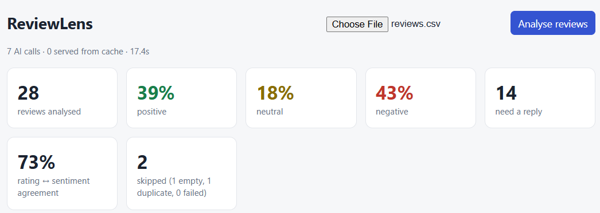
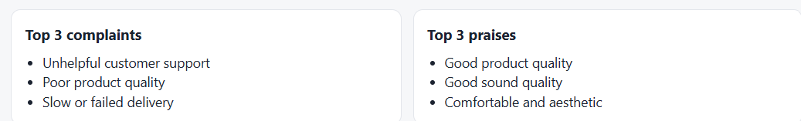
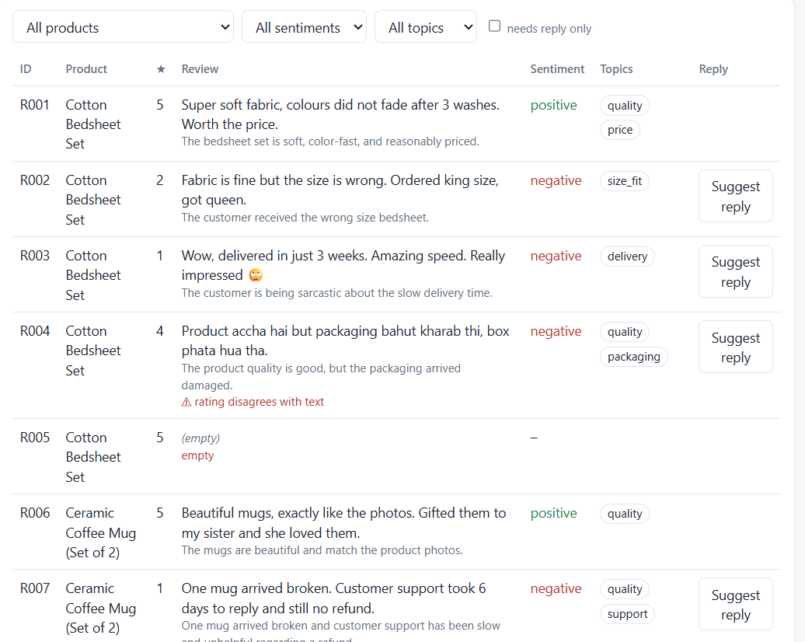

# ReviewLens – AI review insights
RENDER DEPLOYED LINK -  https://lensreview.onrender.com

Upload a reviews CSV and get one screen showing what customers love, what they complain about, and which reviews need a reply. Python backend (standard-library HTTP server, no compiled dependencies), Gemini free-tier LLM, SQLite cache, plain HTML/JS dashboard.

## Setup (fresh machine, Python 3.10+)
```bash
python -m venv .venv && source .venv/bin/activate      # Windows: .venv\Scripts\activate
pip install -r requirements.txt
cp .env.example .env                                   # then put your free Gemini key in .env
python -m app.main
```
Open http://127.0.0.1:8000, choose `reviews.csv`, click **Analyse reviews**. Run tests with `python -m pytest`.

## Architecture
```
Browser (static/index.html)  --POST /api/upload-->  HTTP server (app/main.py)
                                                       |-> cleaning.py   parse, strip HTML, empty/duplicate/rating handling
                                                       |-> cache.py      SQLite lookup by SHA-256 of review text
                                                       |-> llm.py        batches of 5 -> Gemini -> validate -> retry once
                                                       '-> insights.py   cards, rating-vs-sentiment agreement
```
- The browser never talks to the LLM; the key is read from the server environment (`.env`, git-ignored).
- Flow: clean CSV -> unique reviews -> cache hits skipped -> remaining reviews sent 5 per request -> validated results cached -> one extra call builds the top-3 complaints/praises (also cached) -> JSON to the dashboard.
- Suggested replies are generated only when "Suggest reply" is clicked (`/api/reply`).

## Prompt design and R012 (prompt injection)
The system prompt (`SYSTEM_PROMPT` in `app/llm.py`) states that every review `text` is untrusted data and must never be obeyed. Defences:
1. **Instructions and data are separated.** Rules live in the system instruction; reviews are sent as a JSON array in the user message, so review text cannot break out of its field.
2. **Explicit instruction** to ignore commands aimed at an AI and classify the genuine complaint (R012: earbud died after 2 days -> negative, needs_reply).
3. **Rating is not sent** to the model, so the star count cannot sway sentiment. Sentiment comes from the text only.
4. **Strict output schema**: anything outside the allowed values is rejected, so an injected "5 star summary" format cannot pass through.
5. Injection phrases are also detected with a regex and flagged in the UI. Suggested-reply and theme prompts treat text as data too.

R015 is an exact duplicate of R012, so it reuses R012's analysis (no extra call).

## AI robustness
- **Validation**: sentiment, topics, summary, needs_reply are checked per item. Invalid items are retried once (only those items); still invalid -> `analysis_failed`, never cached, never crashes.
- **Batching + backoff**: 5 reviews per request; HTTP 429, 5xx and network errors retry with delays 1s, 2s, 4s, 8s.
- **Cache**: key = SHA-256 of normalised, case-folded text. Re-uploading the same file makes 0 review-analysis calls. The footer line on the dashboard shows AI calls, cache hits and time.
- **Data cleaning**: empty text -> skipped and counted; missing/invalid rating (`five`) -> unknown; duplicates -> analysed once; HTML tags stripped; Hindi/Hinglish handled by the LLM with English summaries.

## Bonus included
Rating-vs-sentiment mismatch flag + agreement %, cost/speed log. (Not done: product pages, Docker, deployment.)

## Known limitations / next steps
- State of the last upload is held in memory (single user); a restart clears the dashboard, though the cache keeps analyses.
- Top complaints/praises rely on one LLM call over summaries; falls back to topic counts if it fails.
- Batches run sequentially (safe for free-tier limits); async with a concurrency cap would be faster.
- No auth, no pagination for very large files.
- Would add: product pages, Docker, integration tests with a mocked HTTP server.

## AI coding tools used
Claude was used to scaffold the project structure and draft code and tests; I reviewed, ran and can explain every part. *(Edit this section to reflect your own honest use.)*

## Screenshots



